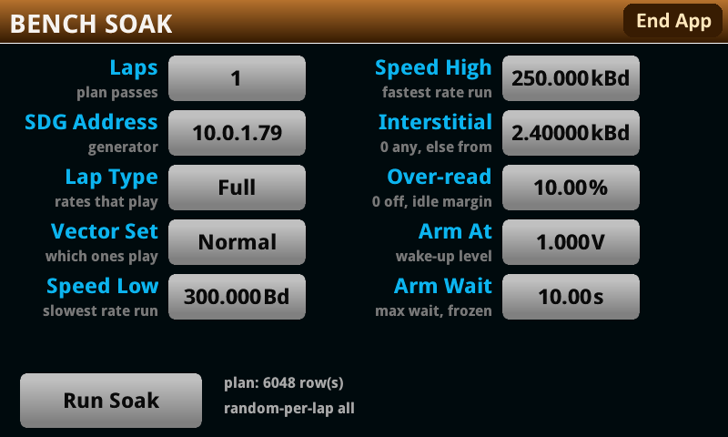

# Serial Brun — starting a bench soak from the front panel

**Ian Ameline** · version 1.70 · MIT licence

`Serial_brun.tspa` puts the bench engine behind a settings screen on the instrument, so a lap can be
started with nobody connected. It is the same `brun.soak()` the host drives — a second door into one
engine, not a second engine. Everything `tools/run_bench.py` did still works, and a host-driven load
leaves this screen available for the next lap.

**It is bench scaffolding and is not the Serial Decode app.** It carries the whole app inside it,
because the engine measures through `sdec.acquire()`, but it installs separately and shows its own
screen. Do not install it on an instrument you want as a serial analyser.

## What it cannot do, and why that shapes the screen

**It cannot draw a plan.** `tools/soakplan.py` draws the cell list on the host and the USB key
carries it as `/usb1/SERDEC/PLAN.CSV`. Re-deriving that draw on the instrument would be a second
implementation of the one thing every lap is compared against — the amplitude, the offset and the
wait are all keyed off the cell index, so a plan drawn twice is two different experiments wearing one
name.

So the screen **narrows a plan that is already there**. Push one once:

    python3 tools/run_bench.py --push-plan                          # the full draw
    python3 tools/run_bench.py --push-plan --spec v98d:std,v99a:std # a targeted subset

and from then on laps start at the panel. The screen reports what it found, and refuses to start
without it. A `--spec` push **overwrites** `PLAN.CSV`, so the row count on the screen is the only
thing that says which plan is actually on the key.

## The screen

The plan line is read off the key when the screen is built, so it describes what is actually there
rather than what was last pushed from this host. The count is the plan's own `# rows=` header — data
rows, which is six fewer than the line count `run_bench.py --push-plan` reports, that figure
including the header and comment lines.

| field | what it does |
|---|---|
| **Laps** | passes over the plan, 1 to 210. There is deliberately no "forever": an unbounded run started at the panel has nobody watching a host log that would say so. |
| **SDG Address** | the generator, as a pick list. There is no string-entry object in this firmware's set, and a list cannot produce the typo that costs a lap to discover. The live value leads it. |
| **Lap Type** | narrows the plan — see below. |
| **Speed Low** / **Speed High** | the rate window in Bd, inclusive at both ends. Defaults span the ladder: 300 is the slowest rate drawn, 250 000 the decoder's own ceiling. |
| **Interstitial** | a floor under the *drawn* rates only, `0` for none. Standard rates still play below it. At the bottom of the ladder a non-standard rate costs the most seconds and tests the least. |

### Lap Type

| | what plays |
|---|---|
| **Full** | every row the plan holds, which is what the host-driven path runs |
| **Normal** | standard rates only — no drawn interstitial or edge rate |
| **Adversarial** | only vectors known to produce errors |

`Adversarial` is derived, not listed: it is `barb.expect`'s `loud` entries — the vectors the plan
drives into conditions where refusing is the documented right answer. A vector added to that table is
covered here without anybody remembering to update a second list.

## Running one

Press **Run Soak**. The settings screen is torn down and the engine's own status screen takes over,
which is the same screen a host-driven lap shows: lap and cell, the waveform playing, the measured
rate, the error line and a spinner that keeps moving through the parts of a capture that take
seconds.

Two refusals can appear on the plan line instead, and both are worth reading rather than retrying:

**`REFUSED: no plan on the key`** — nothing to run. Push one.

**`REFUSED: a smoke has run on this power cycle`** — a soak started after a smoke fails *every* cell
with `acq: line is idle (no transitions)`, and only a power cycle clears it. This has happened three
times on this bench; the last was 705 cells of 705. The host guard that catches it lives in
`run_bench.py`, so the panel carries its own.

**Stopping** is the front-panel **TRIGGER** key. The run ends after the current waveform and closes
the record, which is what commits it on a FAT key. Cutting the power costs at most the last row.

## The status screen

`Run Soak` tears the form down and `brun.ui_build()` takes over. It is the same screen a host-driven
lap shows — the title changes with the run's tag, so a smoke reads `SD SMOKE` and a soak `SD SOAK`.
Nine lines, and every one of them answers a different question.

The title is **`SD <TAG> - TRIGGER TO STOP`**. The stop instruction lives there because the title is
the one part of the screen that never scrolls and never redraws; the body's 58 characters are all
needed for what changes.

| line | reads | what it is for |
|---|---|---|
| **headline** | `SOAK HEALTH 97% RUNNING 5420k` | the answer from across the room: health, the run's state in a word, and the Lua heap. Red if it gave up or the heap is past `heapbadk`, green while healthy, amber when either is borderline, cyan before there is a figure at all. |
| **spinner** | `\|` top right | one character, redrawn six times a cell, driven from inside the app's long loops. If it stops moving the instrument is wedged, not merely slow — it keeps turning through `sdec.acquire()`, which is 58 % of a cell and where a hang is most likely. |
| **lap / cell** | `L1 C86 r86 Ran: 4m Left: 2m` | position in the lap, then the lap's own elapsed and remaining. `r86` is the plan's **own** cell label and appears only when it differs from the position — the record writes rows as `L<iter>C<label>`, so that is the number to search for. |
| **totals** | `Total: 12m of 1.4h - 86/1512 c 6%` | elapsed of the **projected** total, then cells done out of the whole run. Not a second countdown: "left 853.8h" says nothing about how long the thing was ever going to be. |
| **stimulus** | `v98d 9600 Bd 8N1 SER_LoremGap100ms_8N1_x10` | the vector, the commanded rate, the expected format and the generator's **own** waveform name. The full name rather than the short form, because that is what `ARWV NAME` was sent and the one thing that can be checked against the generator. |
| **refusals** | `Refusals: Allowed 12 Unexpected 0 of 86 cells` | cells that refused to decode. `Allowed` is the vectors the plan drives into conditions where refusing is correct; `Unexpected` is the count that matters. |
| **vector** | `Vec: v98d 4 of 20 bad   I3 L0 S1` | this vector's own failure count beside the run's, because the two answer different questions — whether the soak is healthy, and whether **one** waveform is the reason it is not. `I`, `L`, `S` are idle, levels and swing; initials because spelled out at six-figure totals the line is 70 characters against the 58 the glass holds. |
| **log** | five scrolling lines | stamped with the lap and cell they happened at. This is what says *when* something started, which is the row that pays for itself on a run nobody is standing at. |
| **errors** | `Errors: 22  Bad: 640/17160  nodec 10  flag 7  wrong 5/132` | see below. |

### The error line

`Errors:` leads with the total of all three classes. Each class is written only when it is nonzero, so
a clean run reads `Errors: 0` exactly and a reader's eye is not trained to skip a row of zeroes.

- **`Bad: b/t`** — payload **bytes**, wrong over compared. This is the one to read first: `wrong 5/132`
  says five cells are bad and nothing about whether that is a byte each or a whole payload each.
- **`nodec N`** — cells that decoded nothing on a vector that should decode.
- **`flag N`** — cells where the app itself flagged a large share of its frames. Healthy cells run 0 to
  2 % flagged and the wrong ones 30 to 55 %, so this is the class that shows trouble earliest.
- **`wrong N/M`** — cells whose bytes were not the payload, over cells that could be judged at all. The
  denominator is load-bearing: a zero with no denominator is not a pass, it is a question nobody asked.

`Bad:` and `wrong:` are derived from the same comparison inside one gate, so they always describe the
same set of cells. When the line will not fit the glass the per-class breakout is dropped and the
count and the byte figure are kept — a bad run is exactly when this line is widest, so a byte figure
living in the droppable part would be invisible whenever it mattered.

**The panel is not the oracle.** The error line is a health indicator computed on the instrument; the
verdict comes from the host judge below.

## Reading the result

The record is `/usb1/SERDEC/SOAK.csv` on the key and the panel is not the oracle — the error line is
a health indicator, and a lap's real verdict comes from the host judge:

    python3 tools/run_bench.py --fetch --no-load
    python3 tools/judge_bench.py --verbose out/bench/SOAK.csv

The error line reads `Errors: N  Bad: b/t  nodec N  flag N  wrong N/M`. `Bad:` is bytes and `wrong:`
is cells, and the difference matters: `wrong 5/132` says five cells are bad, where `Bad: 251/1313`
says four fifths of the bytes were fine and the damage is localised. When the line will not fit the
screen the per-class breakout is dropped and the count and the byte figure are kept.

## Installing

    python3 tools/package_tspa.py --bench          # writes Serial_brun.tspa

Copy it to the key's root and install it from **Menu > Scripts**. It needs the same USB key the
record and the plan live on.

## What it does not change

The host path is untouched. `run_bench.py --start --detach` behaves exactly as before, including its
own smoke-poison guard and the key pruning it does first. The panel's settings are applied to the
same `brun.*` fields the host sets, and every filter defaults to nil — so a host-driven lap reads the
rows it always did, whatever was last chosen on the glass.
