# Serial Decode — user manual

**Ian Ameline** · version 1.74 · MIT licence

This app turns a Keithley bench instrument into a serial decoder. Clip onto a UART line, press
**Capture**, and read the bytes on the front panel. You do not have to tell it the baud rate, the frame
format or which way up the signal is — it works all of that out from the signal itself.

It was written on a **DMM6500**, and it is known to run on a **DAQ6510** and a **DMM7510** as well — the
7510 decoding a hardware serial device at 9600 baud. It will install on an **SMU2461** and try; that is
the one model nobody has run it on. **Every measured number in this documentation is a DMM6500 number**,
so on another model treat the rates and the tolerance figures as inference rather than specification.
**Which instruments** in [PROJECT.md](PROJECT.md) says which is which.

Three things make it worth reaching for over a scope's decode: the **window is large** — a screenful is
~240 bytes and a recording holds 32 768 — every capture is **appended to the USB key automatically** while
a key is in the slot, and the **serial parameters are detected rather than configured**.

> **Every number in this manual was measured on a real DMM6500** against a real signal generator unless
> the text says otherwise; anything calculated or untested says so where it appears. What that cannot
> cover is the variety of real devices, so if the app tells you something you can prove is wrong, that is
> the bug worth reporting. It is built so that **refusing with a reason is acceptable and confident
> nonsense is not**, and anything it is unsure of it says on the note row at the bottom of the screen.

---

## Hooking it up — read this part

**The line must stay between −10 V and +10 V.** The app fixes the meter on its 10 V range. 3.3 V
CMOS, 5 V TTL and a 6 V LIN line tapped to ground are all fine as they are. For a 12 V line, put a
2:1 resistor divider in front of it — and if it is an open-drain bus, pick resistors big enough not
to load it down.

**Connect INPUT LO to the ground of the circuit you are probing.** Everything is measured at INPUT HI
relative to INPUT LO, so without a shared ground the readings mean nothing.

**Do not put a differential bus straight across HI and LO.** RS-485, CAN and LIN need to go through a
transceiver first, or you need to tap one side of the pair against ground.

**A DC offset does not matter.** The app measures the two voltage levels on your line and puts its
decision threshold between them, so it does not care where they sit — only that both fit inside
±10 V. A 1.6 V swing sitting up at 6 V decodes fine. **The tested range is a 0.33 V swing to an 8 V
swing**, and signals spanning 9.3 V peak-to-peak decode when the extra span is spikes on a smaller
logic swing. A 60 mV swing is refused outright.

**A small swing needs a quiet line, not a special setting.** The noise the app tolerates is a
fraction of your swing, around 40 %, so 50 mV of noise is nothing on a 3.3 V line and a tenth of the
budget on a 0.5 V one.

**The app takes over the measurement function, and gives it back when you end it.** Capturing means
digitizing, so every press of Capture selects **Digitize Voltage** on the 10 V range — whatever the
meter was measuring before. The mode you were in is read once when the app starts and put back when
you press **End App**, so ending the app leaves the meter measuring what it was measuring when you
launched it, on the range it was on.

Two things follow from that:

* **Changing the function from the front panel while the app is loaded does not stick.** The next
  Capture selects Digitize Voltage again — so the app keeps working — and End App
  restores the mode from when you *launched*, not the one you switched to.
* **If you were already in Digitize Voltage when you launched**, the app puts your range, sample rate
  and aperture back too, since those are the settings it changes.

---

## Quick start

1. Connect the line to **INPUT HI** and its ground to **INPUT LO**.
2. Press **Capture** while the device is talking.
3. Read the bytes. Press **View** to switch between hex and plain text.

That is the whole normal workflow. The first capture also locks the baud rate when it is confident,
so later captures are faster.

**If the device is not talking yet, press Capture first and it waits for it.** The app arms the
instrument's **analog trigger** a volt off the resting level and holds for up to 10 s — chosen to
outlast a hand reaching for a power switch — then opens the window just *before* the first start bit,
so the device's first byte is whole. That is the way to read what a board says as it powers on, which
is often the part you cannot get any other way. Lock the baud rate first if you know it, because a
line that has not started cannot be measured. The settings and the rest of the behaviour are under
**Waiting for a device that has not started**.

Two more things before you need them: **Mode** turns Capture into a recording of up to
32 768 bytes straight to the USB key, still one press — and once a long job starts, **nothing stops it
early**, so decide the size before you press — see **The TRIGGER key** below.

---

## The screen

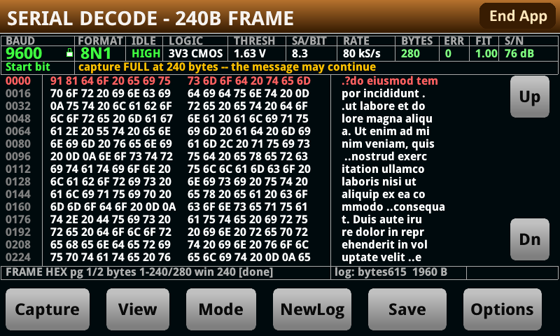

Along the top are the things the app worked out about your line:

| Field | Meaning |
|---|---|
| **BAUD** | The rate it found. A padlock means it is locked and will not be re-detected. |
| **FORMAT** | Data bits, parity, stop bits — `8N1`, `7E1` and so on. When the decode used **MSB-first** bit order the cell gains an `M` — `8N1M` — and an unmarked `8N1` means LSB first, which is what almost every line is. **The stop-bit count is what the capture could show**, which is not always what the line sends: a second stop bit is one more bit time of mark, so it is readable from the spacing between frames only when the device sends them back to back. On a gapless stream a two-stop line reads `8N2`; where the device pauses between bytes, or the capture holds too few frames to be sure, the cell stays `8N1` rather than guess. Either way the **bytes are the same** — a second stop bit is idle, and idle between frames is always tolerated. |
| **IDLE** | What the line rests at: `HIGH` for CMOS/TTL, `LOW` for an RS-232-style line. |
| **LOGIC** | The family it looks like, e.g. `3V3 CMOS`, `5V TTL`. |
| **THRESH** | The voltage it is using to tell 0 from 1. |
| **SA/BIT** | Samples per bit. More is better; 8 is comfortable, 4 still works. |
| **RATE** | How fast the meter sampled. |
| **BYTES / ERR** | How many bytes came out, and how many of them you cannot trust. |
| **FIT** | How well one bit-length explains what it measured, from 0 to 1. Below about 0.9 means the timing was messy. |
| **S/N** | How far your two logic levels stand above the noise sitting on them, in dB. Bigger is quieter. |

A dash means "not measured yet".

**`FIT` and `S/N` are coloured, and the colour is the quick read.** Green means there is margin, amber
means there is some but not much, red means you are close to the edge — so the top line can be checked
at a glance instead of remembering two sets of numbers:

| | green | amber | red |
|---|---|---|---|
| **FIT** | 0.90 and up | 0.72 to 0.89 | below 0.72 |
| **S/N** | 30 dB and up | 15 to 29 dB | below 15 dB |

`FIT` 0.90 is the same figure auto-lock requires, so a green `FIT` is also "this capture was good
enough to lock". **Red means close to failing, not failing.** A red `S/N` still decodes: the point
where captures stop working is around 12 dB, and past it the app says `no clear logic levels` rather
than handing you wrong bytes. Green `S/N` is noise under about 5 % of your swing, amber down to about
a third of it.

**`S/N` describes your wiring, not the app.** It is measured on the flat parts of the signal, away from
the edges, so it reports what is riding on your levels — mains hum picked up by a long unshielded lead,
a switching supply, a noisy ground. If it reads low, the wiring is worth fixing before anything else:
every other tolerance in this manual is a fraction of the swing, so noise spends the same budget that
jitter and slow edges do. The cell stops at `>99 dB` rather than counting higher: above that it would
be reporting the meter's own digitizer resolution rather than anything about your line.

**Broken bytes are shown, not hidden.** `ERR` turns red when there are any, and every row containing
one is drawn red across its whole width — offset, hex and ASCII together. Flagged bytes read as
`?` in the ASCII gutter:

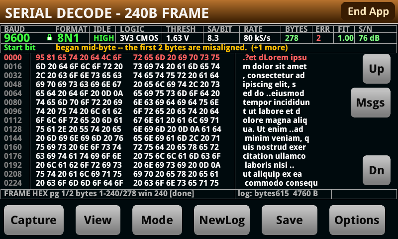

That is a real 240B capture that began part way through a byte. **The note row names the cause** —
`began mid-byte -- the first N bytes are misaligned.` — the app arms on a busy line, so it lands
wherever the traffic happens to be, and the
bytes before the first gap between messages cannot be framed. On a busy line roughly one capture in
eight starts this way.

**The note and `ERR` agree.** The note's number is how far the damage reaches —
the last byte in the opening region the decoder could not frame — so "the first N" is literally true,
nothing past N is being accused, and `ERR` is never less than N. Above, both say 1. `ERR` counts the whole
region rather than only the frames that failed a check: inside a misaligned head the bit boundaries are in
the wrong places, so a frame there can satisfy its parity and its stop bit by luck and still hand back an
ordinary character that is the wrong byte.

Two exclusions keep `ERR` at 0 on good data. Where no misaligned head is identified, the first three
frames are ignored: a gapless line has no idle for the framer to anchor on, so it routinely resynchronises
a frame or two in, and counting those would read `ERR 1` or `ERR 2` on every healthy capture. The final
frame is ignored always, because the capture boundary cuts it in half. Neither exclusion applies across a
head the app has evidence for.

Everything from the first gap onward decoded cleanly, and the log on the USB key holds every byte: one
that failed its parity or stop bit is written and marked, not dropped.

Underneath: the **trigger cell**, the bytes, then two rows of text. The **status row** tells you where
you are (`FRAME HEX pg 1/1 bytes 1-239/239 win 240 [done]`) and names the log file.

**Which mode you are in is in the title bar** — `SERIAL DECODE - 240B FRAME`, `- 8K CAPTURE` or
`- 32K CAPTURE`, in the largest type on the screen.

**The cell at the left of the note row is what a capture waits for**, colour-coded so a glance is
enough: green `Start bit` (the normal case — it waits for the line's own start bit), yellow `Free run`
(it does not wait for anything), cyan `Trigger key` (it waits for the physical key).

**The cell at the bottom right is the rear BNC**, and it is **empty when the rear BNC is off** — which
is the default. When it is not, it names the direction: green `TRIG IN`, amber `TRIG OUT`,
cyan `TRIG I/O`. A trailing `?` means the input is switched on but *not in force*, which happens
under `Free run` — free run means do not wait, so there is nothing for the input to gate.

During a recording the status row carries a live counter — `recording... 40 % of the buffer`, then
`decoding... 4096/8192 bytes` — with a **cyan progress bar** beside it, and the cell to its right reads
`Capture or Mode = Stop`.

**View** switches the byte display to plain text, which is what you want for anything human-readable —
and a row carrying a flagged byte is red here too:

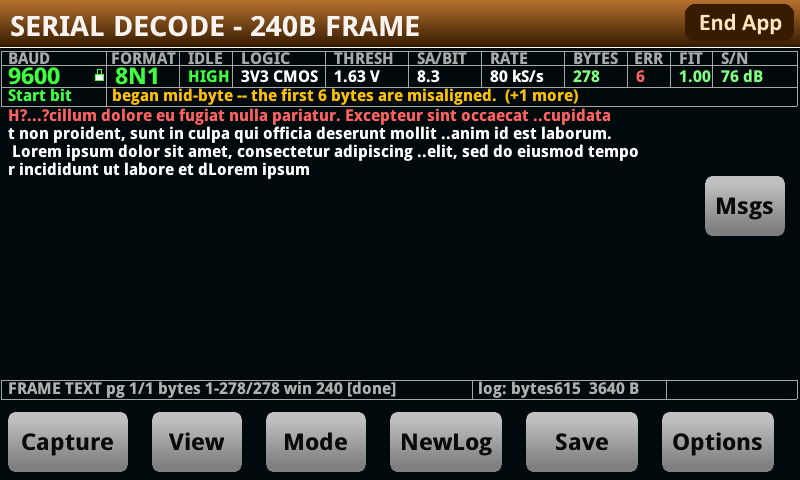

**The note row is the important one.** Warnings appear there — an ambiguous baud rate, a line that
disagrees with the rate you locked, a recording that stopped early. If more than one applies it ends
with `(+2 more)`, and pressing **Save** writes all of them to a file.

Here it is doing that — a capture that started part way through a byte, which the app detected and
said so rather than showing the misaligned bytes without comment — 13 of them, here:

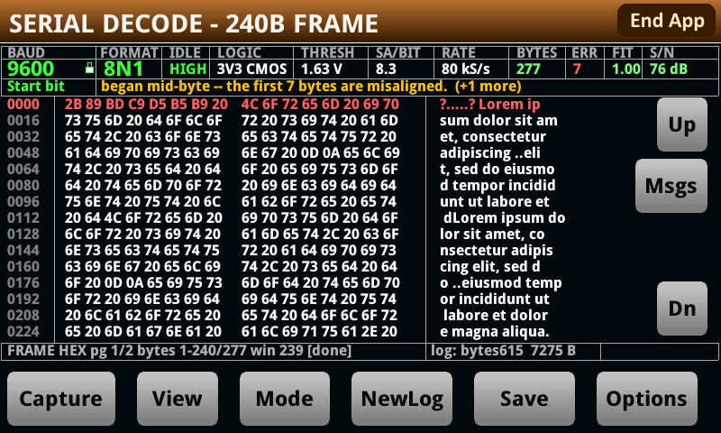

**An empty note row is not a promise that everything is perfect.** It means the app did not detect
anything wrong. A noise spike landing inside a data bit changes that byte with nothing to give it
away.

---

## The buttons

| Button | Does |
|---|---|
| **Capture** | Take a capture and decode it. In a recording mode, does the whole recording. |
| **View** | Switch the display: hex + ASCII → plain text → back. |
| **Mode** | Choose what Capture does: a screenful, an 8 kB recording, or a 32 kB one. |
| **NewLog** | Start a new numbered log file on the USB key. |
| **Save** | Write a full report of what is on screen to the USB key. |
| **Options** | The settings screen. |
| **Up** / **Dn** | Right-hand edge. Only appear when there is more than one page. Once you press either, **page N of M** appears at the right of the note row — and stays for later captures, which is why some figures here show it on a screen nobody has just paged. |
| **Msgs** | Right-hand edge, directly below **Up**. Opens a screen showing **the app's own messages** — the notes, warnings and errors — each one **in full** and in a larger face than the dump area uses, wrapped across as many of its 13 rows as it needs and never shortened with an ellipsis. It is not a view of the decoded data; the dump area and its **Up** / **Dn** are what page through that. **The button only appears when the note row is holding something back**: either a second note exists, so the row reads `(+N more)`, or there is one note too wide for the row. A single note the row shows completely gets no button, because there would be nothing new to read. The screen has its own **Up** / **Dn** and a **Back**, and its counter names the page, the line range and the number of notes. |
| **Lock Rate** | Right-hand edge. Only appears when the rate is not locked. |

The **Msgs** screen, reached from that button. Both notes here are the app's own and nothing was
planted to produce the figure: the capture auto-locked, which the app reports, and it filled its
window, which the app also reports. The first note is too wide for one row and wraps, with its
continuation indented so a wrapped tail cannot be mistaken for a new message. Up and Dn are absent
because one page holds everything; they appear when it does not.

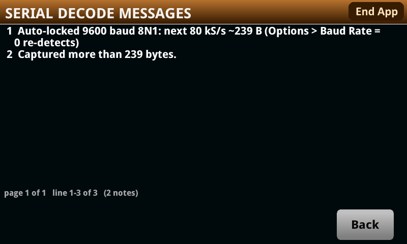

Every button responds immediately except the ones that take a capture. **Capture takes about 1.7
seconds when the rate is locked, and 4 to 9 seconds when it is not** — because to find an unknown
rate it has to capture two or three times. Slower lines take longer. The exact time varies
from press to press because it depends on where the traffic happens to be when you press.

**A press during a capture is not lost — it is queued** and acted on when the capture finishes. So
if the panel seems to ignore you, wait rather than pressing again.

### Paging through a long capture

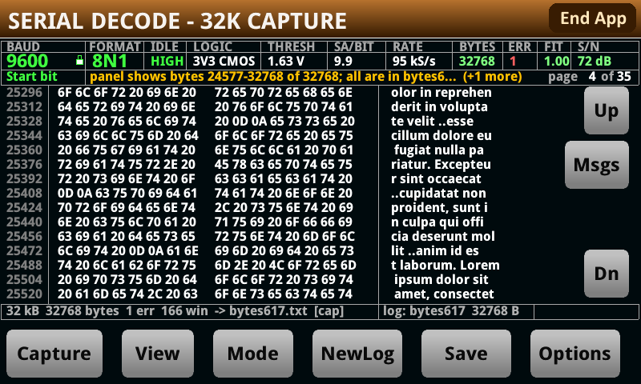

A recording is far more than one screen, so **Up** and **Dn** appear down the right-hand edge and
**page N of M** appears at the right of the note row — the two numbers in white, the words dimmed, so
the count reads at a glance. The note beside it says which bytes are on screen and that the whole run
is in the file, which is the thing you cannot otherwise tell from a screenful taken out of the middle:

    panel shows bytes 24577-32768 of 32768; all are in bytes054.txt

The offset column agrees with it — the rows start at 25296, not at zero — and the status row carries the
run's own summary: 32768 bytes, 1 it cannot vouch for, 68 windows, and the file it went to. **That 1 is
the same figure as `ERR`**.

**You page through the tail, not the whole run.** The panel keeps the last **8 192 bytes** of a
recording however long the run was; the file keeps all of it. That is why this 32 768-byte capture
shows bytes 24577-32768 and pages 35, not 137 — and why the count is the same in either recording
mode, since 8 kB is its own tail.

**The page count follows the view.** Press **View** on that same capture and it becomes 7 pages instead
of 35, because a text row holds 80 characters and a hex row holds 16 bytes — 1200 bytes a page against
240, over the same 8 192:

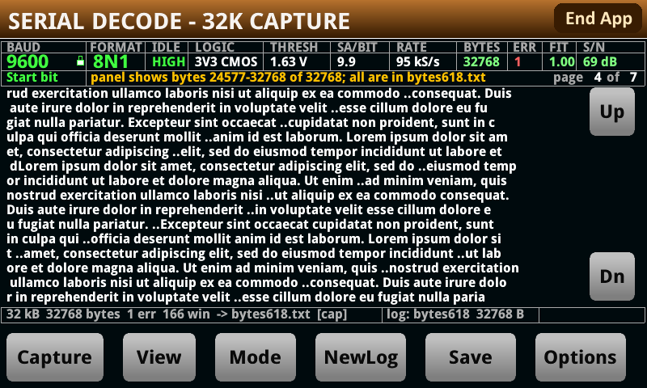

Nothing about paging changes the capture; only how much of it fits on a screen, and the byte range in
the note row is the same 24577-32768 either way. The two figures above are separate 32 kB recordings of
the same line, so their `ERR` and filenames differ — the page counts are what to compare.

## The TRIGGER key — the one hardware button that matters

The **TRIGGER** key is the physical key on the front panel, to the **right** of the screen — the lowest
of that column of buttons. It is not part of the app's own row of buttons. It was intended to do two
things nothing on the glass can do; **one of them works** — timing a capture — and the other, stopping
a long job, does not. Both are described below.

### 1. It does not stop a long job, and nothing else does either

**A recording runs to its own end.** Once you press **Capture** in `8 kB` or `32 kB`, nothing on the
instrument will cut it short — not a button on the glass, and not the TRIGGER key. Decide before you
press. The status row says so before you commit:

    32 kB  ready -- 32768 bytes to a file, no stop once started

**There is deliberately no time estimate.** Two different durations apply and only one is knowable
here: the time your *device* takes to send that many bytes, and the meter's decode, which costs several
times more — 8 kB is a couple of seconds on the wire and around half a minute to decode. A single
number would be wrong, so what you get is the exact byte ceiling and a progress bar.

**What does bound a run,** so it can never hold the panel indefinitely:

- the byte ceiling for the mode — 8192 or 32768;
- a quiet line: **Arm Wait** with no activity ends it, 10 s by default;
- under flow control, 32 windows or 20 minutes of wall clock, whichever comes first. The 20 minutes is
  what matters on slow lines, where a full 32 kB window would take 18 minutes at 300 baud.

**A tap on Capture during a run is not a stop.** It is queued by the instrument and delivered when the
run finishes. The app recognises presses made during the run it has just finished and discards them,
saying so on the note row, rather than starting another recording you did not ask for.

### 2. It can time a capture

Set `Options ▸ Trigger = Trigger key`, press **Capture**, and the capture waits for you:
it fires when you press the physical key, so you decide the moment the line is sampled. Verified on
this hardware — armed on a deliberately idle line, the capture fired on the key press rather than
timing out.

If the trigger you chose never arrives, the capture goes ahead free-running after a few seconds rather
than failing, and the note row says which one was missing.

So the key has exactly one job here: it times a capture, and only when you have asked for that in
`Options ▸ Trigger`. At every other moment — including all the way through a recording — it does
nothing.

---

## How much you can capture at once

Four answers, and almost everyone only ever needs the first. **All of them are one press.**

| You need | Use | Get |
|---|---|---|
| a look at what a device is saying | **FRAME** — just press Capture | ~**240 bytes**, on screen |
| a longer burst, quickly | **Mode** → `8 kB`, then Capture | up to **8 192 bytes**, to a file |
| the longest single recording | **Mode** → `32 kB`, then Capture | up to **32 768 bytes**, to a file |
| more than that, losslessly | flow control, and a device that obeys it | as much as you like, ~20 minutes per press |

**FRAME is the normal case and covers almost all debugging.** One press gives you a screenful,
already decoded, with the baud rate and frame format worked out for you and a copy appended to the
USB key automatically. You do not have to set anything up or lock anything down.

### Recording to a file

Press **Mode** until the cell reads `8 kB` or `32 kB`. **You must lock the baud rate first** — press
**Lock Rate**, or type the rate into **Options**. Then **press Capture once**, and that press does the
whole job: it records, decodes every byte, writes them to the USB key, and comes back with the tail on
screen. There is nothing to press in the middle.

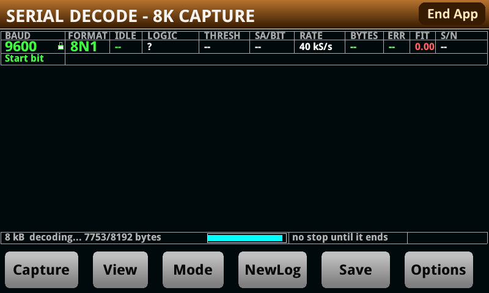

While it works, the counter on the status row moves — first `recording... N % of the buffer`, then
`decoding... N/8192 bytes` — with a cyan progress bar beside it, and the cell to its right says whether
anything can stop it. Above is a real 8 kB run in the *second* phase, decoding 5331 of its 8192 bytes,
with `no stop until it ends` beside it. The measured cells read `--` and the dump area is blank because
nothing has been decoded yet; the baud rate and format show only because they were locked rather than
measured. **There is no way to finish it early** — see **The TRIGGER key** above for what bounds it.

**When it finishes, the note row goes quiet.** The status row's summary — bytes, errors, window count
and filename — is the completion message; the yellow note row is reserved for what went wrong, so an
empty one after a recording means there was nothing to say.

It stops by itself when the window is full or when the line has been quiet for a second. There is also
a 20-minute backstop, so nothing can wait for ever — it only matters on very slow lines, where a full
32 kB window takes 18 minutes at 300 baud.

**Nothing is dropped inside a recording.** What you get is a continuous, in-order run of the line —
verified with a 1024-byte non-repeating test pattern, where the decoded bytes were one unbroken slice
of it.

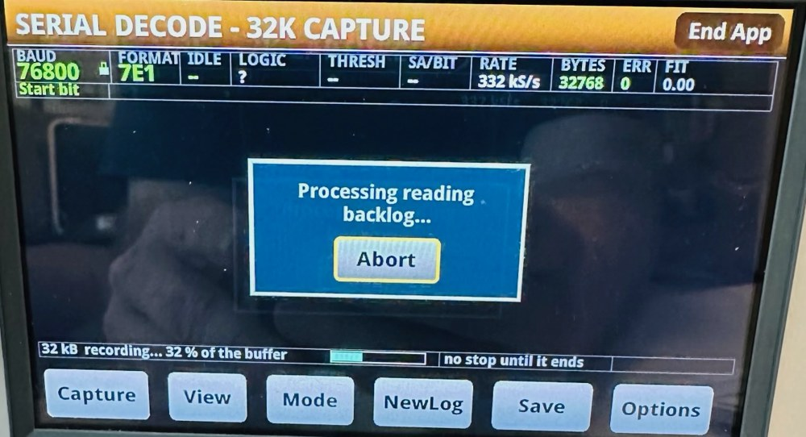

> **If a `Processing reading backlog...` dialog appears, ignore it. Do not press Abort.**
>
> It is the instrument's own message, not the app's: the digitizer is producing readings faster than
> the meter is moving them out of the buffer. It **clears by itself** and the recording carries on
> normally.
>
> Seen on the bench from 38.4 kBd upwards — at 182 kS/s, at 635 kS/s recording a 76.8 kBd line, and
> within a second of pressing Capture at 1 MS/s on a 115.2 kBd line. Every one of those recordings
> completed and decoded correctly, including a full 32 kB one.
>
> Pressing **Abort** would stop the acquisition the dialog is describing, which loses the capture.
> There is nothing to do but let it run.
>
> The photograph above is that dialog over a live 32 kB recording of a 76.8 kBd line at 332 kS/s, with
> the progress bar behind it at 32 % of the buffer and the row beside it reading `no stop until it
> ends`. It is a photograph rather than a screenshot because **the instrument's web
> interface stops answering while the digitizer runs**, so the remote screen grab cannot capture this
> dialog at all -- eight attempts timed out. If you need to document or report something that happens
> during an acquisition, a camera is the only way to see it.

### Which window size to pick

The window is the unit of work: one press records a window, decodes it, and files it. So the size is a
straight trade, and neither choice affects what gets decoded — both are lossless.

| | `8 kB` | `32 kB` |
|---|---|---|
| Bytes per press | 8 192 | 32 768 |
| Recording, at 9600 baud | ~8.5 s | ~34 s |
| Decoding afterwards | ~30 s | ~2 minutes |
| Best for | seeing something soon, and stopping soon | the most data for the fewest presses |

**Decoding is the slow part**, and it is slower than the line: the meter decodes roughly 300 bytes a
second whatever the baud rate. That is why `8 kB` feels much more responsive even though both are one
press.

**The app starts in FRAME**, and one press of **Mode** reaches `8 kB`, a second `32 kB`.

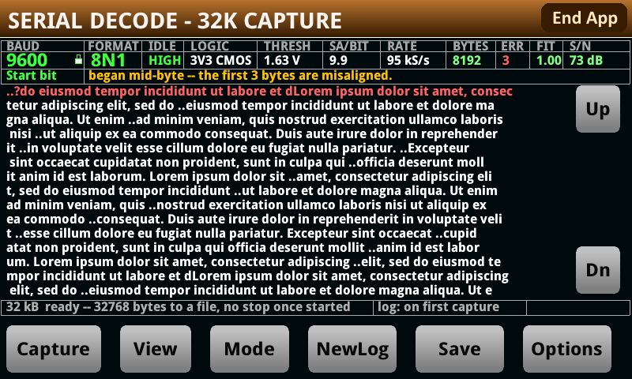

Above: an 8 kB recording has finished and **Mode** has been pressed once, so the title bar reads
`32K CAPTURE` while the previous run's retained tail is still on screen. `Up` and `Dn` have appeared
because the tail is more than one page, the status row states the next run's ceiling and that nothing will
stop it, and **the note row is empty**, because a recording that worked has nothing to warn about.

**The mode you choose stays chosen.** The title bar says which one you are in — `SERIAL DECODE - 240B
FRAME`, `- 8K CAPTURE` or `- 32K CAPTURE` — and a recording that finishes leaves it alone, so pressing
Capture again records another window. Only **Mode** changes it. Two things move it for you, and both say so
on the note line: **Options ▸ Auto Detect**, because auto-detection cannot run in a recording mode at all,
and clearing the baud rate, because a recording needs it locked.

### More than one window: flow control

A window is not a total. If your device is built to wait, you can capture as much as you like without
losing a byte, **and without pressing anything per window** — up to 32 windows or 20 minutes per press,
whichever comes first. To carry on past that, press **Capture** again; it resumes where it stopped, in a new file.

Set `Options ▸ Rear BNC = FC Out`. The rear EXT TRIG OUT then emits **one pulse each time a capture is
armed** (measured on a scope: idle-low at +0.20 V, +4.45 V high, 5.72 µs wide with a 436 ns rise — the
width is the meter's own default and this firmware does not let the app change it) — a credit meaning
*"send now, and send no more than one window's worth"*.
Then one press of **Capture** runs the whole conversation: credit, record, decode, file, credit
again — round and round, with the window number on the status row, until the device stops sending.
While the app is decoding, nothing is armed, no credit is issued, and a device that waits stays quiet,
so the gap where bytes could be lost is closed. Everything lands in one file, in order.

It ends when your device goes quiet after a credit, or when it reaches one
of two backstops: **32 windows** or **20 minutes**. There is no key that ends it early. Those exist so a device that never stops talking
cannot leave the panel busy for ever, and the 20 minutes is usually the one you meet — decoding a
window takes longer than recording it, so 20 minutes is about eight windows at 9600 baud rather than
32.

If it stops for either reason it says which, and how to carry on: **press Capture again.** A finished
recording leaves you in the mode you chose, so it is one press, and the bytes that follow go into a **new**
numbered file. **Nothing is lost in the gap** — your device only transmits when it is credited and no
credit goes out until the next recording arms, so it is still waiting exactly where the run stopped. You
get one conversation split across two files, in order.

Three things your device has to get right:

- **Catch a 5.7 µs pulse.** That is short: use an interrupt, an edge-triggered input or a hardware
  latch. A firmware polling a GPIO in a loop can miss it, and at 250000 baud 5.7 µs is under 1.5 bit
  times. It is a pulse per window, not a level you can poll once.
- **Send no more than one window per pulse** — 8 192 or 32 768 bytes depending on the mode. The pulse
  carries no size information, so the limit has to be built into your firmware.
- **Go quiet when it has nothing to send.** That silence is what tells the app the transmission is
  over.

**Honest limitation:** the pulse itself is verified — +4.45 V, 5.72 µs, 436 ns rise, one per arm,
measured on a scope — and the loop that issues them is tested. The full round trip, with a device that
actually waits for the pulse, has **not** been tested here: the signal generator on this bench stayed
silent through a credit, and whether that is its trigger input or its burst arming has not been
separated yet. The leading suspect is the width, since 5.72 µs is the narrowest pulse this bench can
present and the generator's own minimum is not specified anywhere. So you would be the first to
close the loop. **Triggering, in both directions** in
[REFERENCE.md](REFERENCE.md) has it gate by gate.

### How long a recording gets you

Two different times: the **signal** that ends up in the file, and the **waiting**
before the buffer is full. Below about 19200 baud they are the same. Above it they are not, because the
meter writes about **100 000 readings a second** into its memory however fast the digitizer is told to
sample. The samples are properly spaced and the record is complete — gathering them just takes longer than
the stretch of line they represent.

Do not confuse that ceiling with the sample rate. The **sample rate** decides how many samples land in each
bit, and it is what limits recording to 153600 baud (below). The **100 000 readings a second** is not about
fidelity at all: it is how fast readings reach memory, and it decides only how long you wait.

| Locked rate | Signal you get | Waiting for the full 32 kB |
|---|---|---|
| 300 Bd | 1092 s | the same |
| 1200 Bd | 273 s | the same |
| 2400 Bd | 136 s | the same |
| 4800 Bd | 68 s | the same |
| 9600 Bd | 34 s | the same |
| 19200 Bd | 17 s | the same |
| 38400 Bd | 8.5 s | about 17 s |
| 57600 Bd | 5.7 s | about 17 s |
| 115200 Bd | 2.8 s | about 18 s |
| 153600 Bd | 2.1 s | about 21 s |

Every row is the same 32 768 bytes — what changes is how long that takes to go past. The `8 kB`
window is a quarter of each figure. Then add the decoding, which does not depend on the baud rate:
about two minutes for 32 kB, half a minute for 8 kB.

**You do have to fill it.** There is no way to stop a recording early — see the TRIGGER key section
above — so choose the window with the whole wait in mind.

**153600 baud is the fastest rate that can record. Above that, FRAME only.**

The reason is that a recording and a frame capture do not get the same sample rate out of the same
request. A frame capture gets very nearly the 1 MS/s it asks for; a recording's burst acquisition loses
about half a microsecond per sample, so the same request delivers about 662 kS/s. The floor is four
samples per bit, and the crossover works out at **165563 baud** — so of the standard rates, 153600 is
the last one that clears it, at 4.3 samples/bit.

Above it the app **refuses before you press**, on the note row, naming the figure a recording would
actually get:

    192000 Bd: a recording gets 3.4 samples/bit, under the 4 floor -- use FRAME

That figure is deliberately the recording's, not the header's. The `SA/BIT` cell will read about 5.2 at
192000 baud, which is true of the frame capture it was measured from — the two are different
acquisitions, and the note says which one it means.

**At the other end of the range a recording oversamples, where it used to run at the floor.** At 9600
baud and below — which is what nearly every hardware debug port runs — a recording now samples at
8.0 to 8.3 samples per bit instead of about 4.1. At 19200 it gets 5.89 instead of exactly 4.00.

None of it costs a byte. Decode cost is per sample, so the decoder's ceiling and the wire's output
compare like this: ceiling is `1/(framebits × samples_per_bit × tread)` bytes a second and the wire
produces `baud/framebits` — and setting one against the other cancels both the format and the baud,
leaving a single condition:

    a recording loses nothing while its delivered sample rate stays under about 120 kS/s

That is why 9600 can afford eight samples a bit and 19200 can afford 5.89: both sample under that
rate. Above 19200 nothing is free — 38400 already has to sample at 200 kS/s just to hold four samples
a bit — so there the floor stays at four and bounds the loss instead of preventing it.

What the oversampling buys is a different bit decision. Below six samples a bit the decoder reads
**one sample** per bit, so a single noise excursion at that instant flips it; at six or more it
majority-votes three taps spanning the middle 40 % of the cell, and two have to be wrong together.
Every rate from 300 to 9600 now sits on the right side of that line and used to sit on the wrong one.

**19200 takes the margin rather than the vote, and that is deliberate.** Six samples a bit there means
sampling at 160 kS/s, which is past the no-loss rate — a line transmitting more than about 85 % of the
time would start dropping data, and a boot-log dump is exactly that line. 5.89 is 47 % more samples a
bit than before at no cost whatever, and the decoder reads only three samples per bit in any case, so
what is given up is placement precision rather than information.

There is no setting for any of this. The right value is what the instrument
can deliver without losing data, and it differs per baud.

**The rate is chosen per mode, not just per baud**, because a byte-capped mode holds
`bytes × framebits × samples_per_bit` readings and the reading ceiling is finite. Each takes the most
oversampling its own buffer can hold, so neither is oversampled into a capture the instrument then has
to shorten. At 9600 both land on 100 kS/s and 9.91 samples a bit — the 32 kB mode's 3.41 million
readings fit the ceiling — so at the shipped ceiling the bound only separates them for a frame format
forced wider than ten bits, where 9 data bits with parity and two stop bits is a third more readings
for the same bytes. It reaches further down as the ceiling falls: where a default buffer could not be
resized it separates them at plain 8N1 as well.

At 9600 and below the rate is also never above **100 kS/s**, whatever the arithmetic would allow.
Above that the instrument puts up its own notice over the capture — *"Processing reading backlog… the
digitizer is producing readings faster than the meter is moving them out of the buffer"* — which
clears by itself and does not disturb the recording. Avoiding it is therefore cosmetic, and it is free
here: 100 kS/s already gives 9.91 samples a bit at 9600 and the decoder reads three samples a bit in
any case. Faster rates above this band do cross the same threshold and always have, which is why a
recording at 38400 or above can show the notice briefly and still complete normally.

A 32 kB capture at 9600 asks for 3.41 million readings at 100 kS/s, and its capacity — the count plus
the pre-trigger reserve — comes to 3 593 084. The ceiling is **4 076 503**, which is not that case but
the worst one: 110 baud, a 32 kB window and a frame forced to nine data bits with parity and two stop
bits. Enumerating every baud, mode and frame format the app will accept, that is the largest capacity
any of them can ask for, so at the defaults **no recording is ever shortened**. The step below it,
4 076 502, shortens four.

**The reading memory is one pool, and the app takes what it needs out of it.** The instrument holds
**7 080 255 readings across all buffers together** — measured — and `defbuffer1` and `defbuffer2` are
part of that total, so a large default buffer is a recording the app cannot make. At every launch it
frees the room, in this order:

1. **Buffers no other app cleaned up are deleted.** A buffer left behind by an app that was swapped
   out holds its readings until something removes it, and nothing on the instrument shows you it is
   there.
2. **`defbuffer2` is resized back to 100 000** if that is still not enough.
3. **`defbuffer1` is resized back to 100 000** only if `defbuffer2` was not enough on its own. It is
   last because it is the instrument's default *active* buffer — the one your own measurements go to.

**A resize discards every reading in the buffer**, so the app says what it took: a line in
`serial_decode_log.txt` at every launch, naming each buffer and the capacity it had. It reclaims to
the default rather than to just-enough because the loss is the same either way — any resize clears the
whole buffer — so a partial shrink would cost you the same readings and free less. **The capacities
are handed back at exit**; the readings cannot be.

**If you size the default buffers from an `autoexec` script**, the meter comes up large on every boot,
so this happens at every launch rather than once — the log line is where to look, and your sizes are
restored when the app exits. A capacity set by hand does not survive a power cycle on its own.

With the defaults restored that leaves the full **4 076 503** and no recording at any baud is ever
shortened. If the resizes are refused — a meter that will not take the capacity write — the app
records inside whatever is left and shortens the window rather than failing the press, and below the
smallest recording it **refuses at launch rather than at the first press**, naming the buffer that is
still large. There is no dialog: this app is driven headless over the socket, and a box waiting for a
finger would stop an unattended run without saying why, so the refusal goes to the note row, to the
USB log and to the caller.

**FRAME keeps working to the full 250000 baud**, and usefully so: at 192000 baud a frame capture holds
384 bytes.

---

## Reading the bytes

The hex view shows two groups of eight bytes and then the same bytes as text. The offset down the
left is dimmed because it is there to navigate by, not to read. A byte that could not be recovered
shows as `--`.

**`ERR 0` does not mean the bytes are definitely right.** It counts broken stop bits and parity
failures. Noise landing inside a data bit flips it with nothing to detect — which is why the note row
matters more than the error count.

If you see **`began mid-byte — the first N bytes are misaligned.`**: on a line that never goes
quiet, the capture starts wherever it starts, and if that is halfway through a byte the first few
bytes are chopped up wrongly. They are shown rather than hidden, but **do not trust their values**.
Everything after the first gap in the traffic is fine. On traffic with normal gaps between messages it
costs **5 to 12 bytes**; on a line that never pauses it can be far more — **up to 165 bytes measured**
on back-to-back text at 250000 baud, because there is no gap to resynchronise on. A device that pauses
between messages never shows it at all.

---

## Locking the baud rate, and the amber padlock

The app locks the rate for you after a good capture, which is why later captures are quicker. It only
does this when it is confident: enough clean frames came through in one unbroken run, `FIT` was 0.9 or
better, and the voltage levels were steady. **It does not have to be a standard rate** — an awkward
divisor locks too, so its recording modes work without a hand-typed number.

When it is not confident it leaves the padlock **amber** and offers you the **Lock Rate** button. The
bytes are still shown — they just are not trusted enough to carry forward. Press **Lock Rate** to pin
it anyway, or capture again.

**Auto-lock locks the polarity too, but only when something decided it.** If the capture contained an
idle interval the resting level was observed rather than guessed, and that is enough. If it did not,
both polarities are decoded and the polarity locks only if the reading that is not the incumbent won on
something — more frames, more printable text, or fewer errors. An incumbent that merely holds its ground
has not been confirmed by anything, and is not locked. Where the two are indistinguishable the incumbent wins by default,
and that is a coin flip, so it is not locked: polarity goes back to auto for the next capture. See
**Idle high and idle low**.

(**Lock Detected** on the Options screen copies the detected polarity into the fields along with
everything else, where you can see what it picked before you commit it.)

### If the line changes rate, the app gives the lock up

A locked rate is a promise about the wire, and when the wire stops keeping it the lock is worse than
useless — it turns every frame into an error and nothing gets better by pressing Capture again. So when
**all three** of these hold, the app **drops the lock by itself** and re-detects from the same samples:

- a rate is locked;
- the bit time it measures on the wire disagrees with that rate;
- more than a quarter of the frames in the middle of the capture failed.

It says so on the note row, naming the rate it discarded — `19200 baud fit nothing -- unlocked, and
this capture reads 38400` — and from there auto-lock pins the new rate on the usual terms. That is the
same result as typing `0` into Options by hand, which is what you had to do before.

**The middle condition is what protects a rate you typed deliberately.** If the rate fits the wire and
the *format* is wrong, every frame fails too — but the measurement agrees with your number, so your
number is kept.

---

## Options

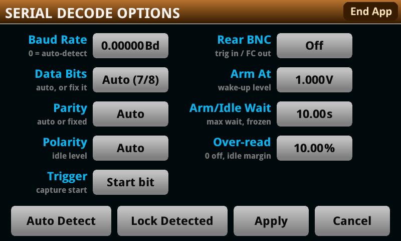

| Setting | What it does |
|---|---|
| **Baud Rate** | `0` means auto-detect. Type a number to lock that rate; it is rounded to a whole baud. |
| **Data Bits** | Leave on `Auto (7/8)`. Only use `Auto (any)` if you know the device sends 9-bit words — it can make a damaged capture look tidier while being wrong. |
| **Parity** | `Auto`, or pin `None` / `Even` / `Odd`. |
| **Bit Order** | `Auto`, `LSB first` or `MSB first`. Almost every UART is LSB first, which is what RS-232 framing specifies, so leave this on `Auto` unless you know otherwise. **Auto cannot always tell**, and the reason is worth knowing: the start bit, the stop bit and the parity bit are all the same whichever end the data bits come from, so the two orders are indistinguishable by framing and only the *bytes* can choose. Auto therefore compares how much readable text each order produces and keeps LSB on anything close. On a line carrying **binary** data there is nothing to compare and bit order cannot be detected at all — pin it here. |
| **Polarity** | `Auto`, `Idle high` (normal CMOS/TTL) or `Idle low` (inverted). Auto decodes both and keeps the one the bytes support; pin it if the line is almost never idle *and* carries no text, which is the one case the two readings can tie. |

Each setting is independent — pinning one leaves the rest on auto.

**Apply** commits your changes and takes a capture. **Cancel** puts everything back to how it was
when you opened the screen. **Auto Detect** forgets everything locked, takes a fresh capture, and
locks whatever that finds — it is the quick way back when you have locked onto the wrong thing.
**Lock Detected** copies the last capture's settings into the fields so you can look at them before
committing.

**Apply takes as long as a capture, because it is one.** Measured on the bench: about **2 seconds**
with the rate locked, and about **4 seconds** with nothing locked, because an auto-detecting capture
costs a whole extra acquisition to find the rate plus a format search. The screen returns to the main
panel immediately and the status row reads `capturing` for the rest of it. If Apply feels slow, lock
the rate — it is the same saving every capture makes, a bit over two to one here. Nothing else on this screen
takes a measurable amount of time: moving between the fields runs no app code at all.

There is no stop-bit setting. A second stop bit looks exactly like a bit of idle line, which the
decoder already copes with, so a 2-stop device decodes correctly and is reported as 1 stop.

### Advanced

Five settings you can ignore unless you need them:

- **Trigger** — what starts the acquisition. `Start bit` (the default) waits for the line to move.
  `Free run` grabs immediately. `Trigger key` waits for the front-panel TRIGGER key, as described
  under **The TRIGGER key** above. **If the thing you asked for never happens, the capture goes ahead
  anyway** — after a few seconds, or after **Arm Wait** on a line that has not started — and the note
  row names the one that did not arrive: `edge trigger unavailable; captured free-running`, or `front`
  for the TRIGGER key. Those bytes are real but they are not lined up with the event you wanted.
- **Rear BNC** — lets an external trigger in on the rear connector, and `FC Out` sends the
  flow-control credit pulse out of EXT TRIG OUT. `FC Out` is what turns a recording into an unlimited
  one; see **More than one window: flow control** above.
- **Arm At** — how far from the idle level the **analog trigger** waits for the line to move, in
  volts, from 0.33 V to 6 V. Default 1 V. Only used on a line that is **not transmitting yet**; see
  **Waiting for a device that has not started** below. Below 0.33 V the comparator starts firing on
  noise on a floating input and arms the capture on nothing; above 6 V the level no longer sits
  inside an ordinary logic swing, since a 6 V arm already needs a 12 V part.
- **Arm Wait** — one setting for two waits, which are the same question asked twice: how long
  this device may say nothing. It is how long an armed capture waits for a line that has not started,
  **and** how long a quiet line runs before it ends a recording. From 2 s to 120 s, default 10 s,
  which is chosen to outlast a hand reaching for a power switch. A 1 s exit would end a recording
  inside the first pause of a startup dump, which stops for seconds at a time between blocks.
  **The panel is frozen for the whole of it**, which
  is what the field's help text means by *max wait, frozen*: at the 120 s ceiling that is a
  two-minute dead panel. It lengthens the wait and never shortens it, so an edge capture always waits
  at least its own 3 s — 2 s and 3 s do the same thing, and the note after an expiry reports the 3 s
  it really waited. It governs `Start bit`; `Trigger key` ignores it and waits its own 30 s for a
  finger.
- **Over-read** — **extra samples to record so the payload still fits.** **10 % is the default.** Any
  pause the line takes is recorded in full, and those samples come out of the same budget the bytes
  do — so without a margin the bytes that go missing are the ones at the end of the recording. Raise
  it on a line that pauses often and briefly, which is where the most silence is recorded. 0 turns it
  off. It costs readings and nothing else: the decoder already skips silence, so this buys payload
  rather than accuracy.

### Short gaps between messages

A device that sends a line, pauses briefly and sends another spends part of every recording on
silence. Those samples come out of the same budget the bytes do, so the pauses decide how much of
the traffic fits — and the bytes that go missing are the ones at the end.

**Over-read** is the setting for this: it records that much extra so the payload still fits. 10 % is
the default, and a line that pauses often wants more. It costs readings and nothing else — the
decoder already skips silence, so it buys payload rather than accuracy.

### Waiting for a device that has not started

**Press Capture before the device powers up and the capture waits for it** instead of recording the
silence. It is the ordinary case on a bench: a board that talks when you switch it on, or when some
event happens to it, and nothing on the line until then. It needs **Trigger** on `Start bit`, which is
the default: `Free run` grabs immediately by definition, and `Trigger key` waits for your finger
instead of for the device.

**The instrument's analog trigger does the work.** A hardware comparator watches the input and fires
when the voltage crosses a level, so there is nothing extra to wire and no digital input involved:
the signal being decoded is the signal being triggered on. From the crossing to the trigger point in
the record is about **7 µs**, measured, and fixed in time rather than in samples — between 200 kS/s
and 1 MS/s the sample rate changes 5× while that figure changes 1.03×. The window opens ahead of the
crossing in any case, so the latency never costs a byte.

**To read what a board says as it powers up**, with the device switched off:

1. Wire it up and leave the device off.
2. **Lock the baud rate** in `Options ▸ Baud Rate` if you know it. A line that has not started cannot
   be measured, and this is the one path where that matters — see the note on the rate below.
3. Leave **Trigger** on `Start bit`. Lower **Arm At** if the line's swing is small or weakly driven,
   and raise **Arm Wait** to cover however long you need to reach the switch.
4. Press **Capture**. The panel reads `waiting 10s for 2.30V -- TRIGGER=go` and is frozen until the
   device speaks or the wait runs out.
5. Switch the device on.

What the app does with it:

- The level probe finds no transitions, which is how it knows. On a line that is already transmitting
  nothing here applies — the threshold is measured from the two levels, which beats any fixed voltage.
- The comparator is armed **Arm At** volts from the idle level, on the side the start bit travels: one
  volt above a line sitting at ground, one volt below an idle-high TTL line, one volt above an RS-232
  line idling at −6 V. On a line idling away from ground the level is clamped at the midpoint, because
  the far level is unknown until the device speaks.
- The window opens **before** the first start bit, not on it, so the first byte is whole. The trigger
  model keeps 5 % of the buffer back as a pre-trigger reserve — on a busy line almost none of it is
  spent, and on a silent one all of it is: **1055 samples** of quiet line ahead of the device's first
  edge.
- The panel says it is waiting: the right-hand cell reads `waiting 10s for 2.30V -- TRIGGER=go` for
  the length of the wait. **The panel is frozen while it waits** — a touch press only queues — so that
  line is the only thing that distinguishes a live arm from a hung instrument.
- **The front-panel TRIGGER key cuts the wait short**, in every setting this screen can produce. It
  is the one escape available: the key is a stimulus of the instrument's trigger model, serviced in
  firmware, so it fires while the app is blocked. Pressing it captures whatever is on the line at
  that moment.
- **Where in the wait the device starts does not matter.** Against a 10 s wait the arm fires at
  +0.3 s and still fires at **+9.7 s**; at +11 s it expires.
- If **Arm Wait** runs out **the capture still happens, free-running**, and the note row says the
  whole of it: `edge trigger unavailable; captured free-running (no trigger in 10 s (edge) -- nothing
  crossed 0.99 V; raise Arm Wait or lower Arm At)`. That names both settings and the level the
  comparator was really holding.

**The rate is a guess on this path, and the panel says so.** Nothing can measure the bit rate of a
line that has not started, so the capture runs at 200 kS/s — 20 samples a bit at 9600, and enough for
anything up to 38 400 — and the note row reads `armed at 200 kS/s on a line that has not started --
lock the baud rate for a longer window`. **Lock the rate in Options and
the capture uses the right one for it**, with a full window and no guessing. Locked, it is reliable
right across the range — **0 bad frames** at 1200, 9600, 38400 and 115 200 baud.

If the bit rate cannot be measured from what arrives, the app tries 9600, 19200, 28800, 31250 and
38400 against the samples it already has, and publishes one only when exactly one of them frames the
bytes cleanly — `decoded at an ASSUMED 9600 Bd; lock the rate to be sure`. Where two rates fit equally
it says so and decodes neither, because a capture that fits 19200 and 9600 alike cannot be told apart
from inside the instrument. **Past the top of that ladder it refuses rather than guess**: a 115 200 Bd
device gives `1.7 samples/bit -- 115004 baud needs a faster capture than 200 kSa/s` — the second
reason to lock a rate you already know.

**Recordings wait too.** An 8 kB or 32 kB recording started on a silent line arms the same way,
records from the device's first byte and decodes it cleanly. While it waits, the recording's own
limits are suspended — the idle watchdog cannot end a run before the device has started — and an arm
that expires ends the run naming the same two settings: `nothing crossed 2.30 V in 10 s -- raise Arm
Wait or lower Arm At`.

An external pulse on the rear connector really does start a capture — verified on this hardware, and
verified by the negative as well: take the pulse away and the capture refuses rather than quietly
grabbing something, with the note row naming what was missing. Two things to know before you rely on
it. The rear input is **OR'd with** whatever **Trigger** says rather than replacing it, so the first
of the two to happen wins the capture — and on a line that is always transmitting that is the start
bit, every time, which leaves your pulse no say in where the window opens. Point it at a line that is
otherwise quiet, or pair it with `Trigger key` so that the only thing it competes with is your own
finger. And under `Free run` the rear input is ignored altogether, because free run means do not wait
for anything — the app says so rather than leaving you to notice: the note row reads `Rear BNC = Trig
In is set but IGNORED`, and the status cell marks it by appending a `?` to `TRIG IN`.

**Trigger** applies to FRAME captures, and to a recording in one case: a line that is **not
transmitting when you press Capture**, where the recording waits for the device exactly as a frame
capture does. A recording of a line that is already talking ignores it and starts immediately — there
is nothing to wait for, and for a flow-controlled recording the thing that decides when the device
talks is the credit pulse, not a trigger. `FC Out` is not confined that way — it pulses once per armed
capture whichever mode you are in, a FRAME capture included. What a recording adds is the repetition:
credit, record, decode, credit again.

---

## Files on the USB key

Two different files:

| File | Written | Holds |
|---|---|---|
| `/usb1/SERDEC/bytesNNN.txt` | automatically, on every capture | the running log — every capture's bytes as text and hex. **NewLog** starts a new number. |
| `/usb1/SERDEC/serial_NNN.txt` | only when you press **Save** | a full report of what is on screen: settings, all the notes, the whole dump. |

**Everything goes in `/usb1/SERDEC`,** and the app creates that directory when it starts — there is
nothing to set up, and nothing lands in the root of your key. The panel still shows the bare filename
rather than the path, because the directory never changes and the row is narrow.

### You can take the key out and put it back while the app runs

**Pull the key whenever you like.** Within half a second the `Save` and `NewLog` buttons disappear, the
log cell reads `log: no USB key`, and the app stops writing. Put a key back and the buttons return, a
fresh `bytesNNN.txt` is started on it, and logging carries on. Nothing needs ending and restarting.

The app checks the slot twice a second while it is sitting idle, which is the only way to notice: the
instrument posts no event when a key arrives or leaves, so there is nothing to listen to. The check
costs about 340 microseconds, or 0.07 % of the instrument. It stops while a capture or a decode is
running, and resumes when that finishes — so a key pulled *during* a long recording is noticed by the
write that follows it rather than by the clock.

**A bad install bluescreens the instrument rather than refusing.** Two versions of this have been
seen on firmware 1.7.17a, and the second matters more because it looks innocent:

* **A corrupted archive on the key.** Recopy `Serial_Decode.tspa` and verify it with `cmp` before
  installing again — see the note in the README's install steps.
* **A capture taken while the app starts up, run from internal memory.** This one is fixed in the
  app, and the fix is a single missing call rather than anything you can configure. Versions up to 1.37 took a capture at the end of their own launch. Installed
  in internal memory, that bluescreened the instrument at the end of that capture — three times out
  of three — while the *same archive* run from the USB key was faultless, and a capture from your
  own press of **Capture** was faultless too. The app no longer captures at launch, which removes
  it: the identical build with only that call taken out ran clean.

  Two things about it cost a day to establish:

  * **The installed copy was not corrupt.** Its stored source was byte-identical to the working
    one — 271345 bytes, 7164 lines, the same CRLF endings, not one differing byte.
  * **It is not a size limit, so making the app smaller does not help.** A purpose-built app with a
    *larger* compiled image and *more* stored source runs cleanly, and stripping 58 kB of comments
    out of this app changed nothing while the launch-time capture was still there.

  Reinstalling from the key is **not** a reliable cure for this — one reinstall looked like one and
  the crash came back, so never conclude it is fixed because a capture or two survived.

**So `tools/cmp_installed.py` proves the text, not the install.** It reads the installed app's own
source back out of the script catalog and diffs it against any commit's archive down to the byte,
which settles exactly which build is on the instrument. It cannot see whatever else the firmware
keeps beside that text, and that is what a bad install damages. **Reinstall from the key before
suspecting the code** — it costs a minute, and it is the remedy that has worked both times.

**Expect about two seconds before the buttons come back after you push a key in.** That is the
instrument mounting the key, not the app waiting — pulling the key is noticed at once, and the
delay is only on the way in. Pressing a button during those two seconds does not shorten it:
every part of the app, the buttons and the clock alike, has to ask the same question of the
firmware, and until the firmware says a key is there the answer is the same whoever asks.

**Tidying the key does not help, so do not bother on this account.** Measured over seven
pull-and-replace cycles with the key's root cut from 30 entries to 16 — 400 files deleted and
both firmware `.upg` images removed — the delay was unchanged. Across those cycles the
instrument reported the key *absent* about four times as long as *present*, on a rhythm that
was close to even by hand: it is the mount, not the amount of data to be scanned.

**`Capture`, `View` and `Mode` also check the slot themselves, before doing anything else**, so a
press never waits on the clock. This is belt and braces rather than a fix for something you would
have seen: a capture already re-opened the log and brought the buttons back before it started work.
What it changes is that each press asks, instead of getting the right answer as a side effect.

**Every write is checked first, so a pull does not produce a pile of pop-ups.** The instrument's
`file.write` does not report a failed write to the program at all — it posts `2200, File write error`
on the panel instead, once per call — so the app asks whether the key is there before each one. Pull
the key mid-recording and the run stops writing and reports the file as incomplete; before that check
existed, a 32 kB recording could put a modal dialog on the panel for every one of its 2048 rows.
Anything still in flight at the instant the key leaves may post a single one.

**The key that comes back is treated as a different key.** The app forgets the filename it chose on the
old one and allocates a new one, because the old name may already be in use on the new key and appending
to a stranger's file is worse than starting another.

**With no key in the slot, `Save` and `NewLog` are hidden.** Both exist only to put a file on the key —
Save writes the report, NewLog starts the next byte log — so with nowhere to write, neither has a press
that could succeed. Capture and decode work perfectly well without a key, in **every mode**; you simply
get no log and no report. A 240-byte capture behaves exactly as usual, and the 8 kB and 32 kB recordings
still acquire and still decode — the bytes go to the panel instead of to a file, and the status row says
`NOT recorded` rather than naming one. The panel keeps the last 8192 bytes, so an 8 kB recording is kept
whole and a 32 kB one shows its last quarter; the note row says which bytes you are looking at.

**You may also see `2205, File not found` during normal use, with a key inserted.** Choosing the next
`bytesNNN.txt` means asking the instrument about names until it finds one that is free, and the
instrument reports each name that is not there. It is a question, not a fault.

**With a key in, a recording decodes into the log file,** so the file holds the whole run while the
panel shows only the tail of it. The note row says so when they differ. Without a key the tail is all
there is, and the note row says that instead.

**A recording does not need a key** — it is better with one, because the file is the only place the
whole run exists. Every mode captures and decodes without one; what you lose is the log and Save.

---

## When something looks wrong

| What you see | What it means |
|---|---|
| `line is idle (no transitions)` | Nothing is crossing the threshold. Check your connection, and check the device is actually talking while you capture. |
| `no clear logic levels` | Too much noise, or the swing is too small. 0.33 V works on the bench, and 0.25 V did too; 60 mV is refused outright. |
| Wrong rate reported | The traffic may be genuinely ambiguous (below). Lock the rate if you know it. |
| Bytes wrong but `ERR 0`, with the rate locked | The device is not running at the rate you locked. The note row warns when the line disagrees by more than 4 %. |
| Bytes wrong but `ERR 0`, rate and format plausible | Either the polarity or the bit order may be the wrong way round, and both look like this: the framing is perfect and the values are not. Check the `IDLE` cell against the line and pin `Options ▸ Polarity`; if that is right, the device may be sending **MSB first**, so try `Options ▸ Bit Order`. A scope that shows the line is correct while the app shows nonsense is the signature of bit order rather than a capture fault. |
| A baud rate that is not a round number | It is reporting what it measured, because the measurement was not within 2 % of a standard rate. |
| A `?` after the baud rate | The app does not stand behind the number: either it measured a rate that is not standard, or it rounded one by more than 1.25 %. The bytes are usually fine. **No `?` is not a promise** — a fit that lands close to the wrong standard rate prints none. |

**Some traffic is genuinely ambiguous, and no decoder can fix it.** Eight `0x00` bytes at 9600 baud
7N1 make exactly the same waveform as four `0x08` bytes at 4800 baud 8N1. The app tells you a rival
rate fits rather than pretending to know. Irregular gaps between bytes remove the ambiguity
completely.

Three cases where automatic detection is known to fail are described under **Known failures of automatic
rate detection**, below. All three are fixed by typing the rate in.

---

## What it can cope with

Measured at 8 samples per bit. Past every one of these limits the app **reports** the problem rather
than quietly getting it wrong, except where noted.

| Condition | Works up to |
|---|---|
| Wrong clock, rate **locked** | **±4 %**. Beyond that a fast device corrupts bytes with nothing to show it |
| Wrong clock, **auto-detect** | ±12 % and past — it measures instead of assuming |
| Jitter | **±15 %** of a bit; past ±20 % it can fail quietly |
| Noise | about **40 %** of the logic swing — roughly 1.3 V on a 3.3 V line |
| Slow edges, long cables, weak pull-ups | filtering up to **0.7 bit times** |
| Logic swing | **0.33 V to 8 V** — the limit is the swing, not the logic family |
| DC offset, logic low at or above 0 V | anything that keeps the line inside ±10 V |
| DC offset, logic low **below** 0 V | anything inside ±10 V, including a line sitting either side of ground — see **Idle high and idle low** |

**Rates from 300 to 250000 baud** decode byte-exact on the bench, and so do odd ones — 900, 1500,
3600, 7200 and arbitrary values like 1379, 8123 and 104857. A 1 kB non-repeating payload is clean at
every one of the eleven standard rates from 300 to 250000, and 30 consecutive captures at 2400 baud
returned ~6 780 bytes with nothing flagged. A rate within 2 % of a standard one is reported as
the standard one, because real devices use standard rates.

**Tolerance follows samples per bit, not baud rate.** A slow line is not automatically the safe one —
read `SA/BIT`.

**If you are writing the firmware at the other end**, two things help: keep your edges within ±15 %
of a bit time (that is ±15.6 µs at 9600 baud but only ±1.3 µs at 115200, so if an interrupt can
delay your transmit loop, send slower), and avoid padding with `0xFF`, which gives the rate detector
only one narrow pulse per frame to measure. `0x00` padding is fine.

---

## Known failures of automatic rate detection

**Read this in proportion.** Most serial decoders require you to tell them the baud rate. This one
measures it, and gets it right on every standard rate and on arbitrary ones like 1379, 8123 and 104857.
Across the current offline measurement — the full bench plan taken from 200 different points in each
waveform, **335 400 captures** — **1 116 reported a rate more than 2 % off, 0.33 %**, and **every one of
them is on a waveform carrying deliberate edge jitter, slow drift or impulse spikes**. Every ordinary
payload reported the right rate at all 200 of its capture points, at standard and odd rates alike. Those
1 116 are four different things, and only two of them are failures of rate detection as such:

| what went wrong | captures | |
|---|---|---|
| rounded up to the standard rate next door, payload intact | 609 | failure 2 below |
| a drifting baseline took the rate **and** the bytes | 436 | 1.0 V of drift down to 5.3 samples a bit, 435 of them on one waveform — past the drift tolerance above, not a detection failure |
| the measurement itself landed 7 to 12 % low | 46 | impulse spikes and 2 % jitter |
| the reading was a multiple of the true rate | 25 | failure 1 below |

**Only 6 of the 335 400 misreport a rate that is itself standard**, all of them one impulse-spike cell
at 19 200 baud doubling to 38 400, at 6 of its 200 capture points. **A standard rate is not immunity,
though**, and the instrument shows it where the simulation does not: the 256-byte repeating blocks at
28 800 baud read 31 250 in every one of four laps, and in one of those four the app had no reservation
about the number.

Three cases are known where the measurement goes wrong, and in all three the remedy is to supply the
rate — which is what other tools ask for as a matter of course. **All three are fixed by typing the rate
into `Options ▸ Baud Rate`**, verified, every frame decoded with zero errors once the rate was given.
The numbers are below so you can judge the risk yourself.

### How it decides, and what defends it

Automatic detection has no clock to refer to. It works in two steps: it measures the gaps between
transitions and finds the longest bit time that divides them all, then weighs that answer against the
standard rates, because a real device almost always uses one.

Gaps of many different lengths pin the measurement down well; gaps of only a few lengths do not. But
where detection fails it is usually not the measurement that is wrong — it is the second step. A
different reading at a simple multiple of the measured rate can land on a standard value while the true
rate does not, and left to itself that coincidence outweighs a correct measurement.

**Three checks stand between a correct measurement and its own multiples.**

* **Where the pulses fall.** At the true bit time some pulses span an odd number of bit cells; divide
  that bit time by an even number and every pulse spans an even count. So a halved, quartered or
  sixthed reading is recognisable from the pulse lengths alone.
* **How short the shortest pulse is.** Dividing by an *odd* number leaves the counts' parity exactly as
  it was, so thirds and fifths are invisible to the first check. What gives them away is that they claim
  a longer minimum. Ordinary traffic has single-bit runs — a ten-bit frame opens with a one-bit start
  bit — so a reading whose shortest run is three or five bit times is describing something else, and a
  reading past about two and a half is refused. A payload whose
  shortest genuine run *is* three bit times or more, such as `0x00` sent with a two-bit gap between
  bytes, cannot have a third-of-the-rate reading accepted. Such a payload reports a third of its true
  rate either way, so this refuses nothing that was working, but it is the shape to watch for.
* **How much of the capture the measurement explains.** The two checks above are switched on by how
  much structure the measurement accounts for — how many distinct pulse lengths it has to explain. A
  reading that covers a whole capture with pulses of only one or two lengths has been corroborated by
  nothing, which is what a repeating pattern looks like. The alternative, arming them only when the
  measurement lands on a standard rate, does not work: the standard ladder is full of factor-of-two
  relations — 1200, 2400, 4800, 9600, 19200 — so a reading sitting on *twice* the true bit time lands
  on a standard rate just as readily as the truth does, and the check then protects the wrong one.

**A one-point win does not displace a measurement.** Where two readings come within a single frame of
each other, the decoded bytes break the tie: the one yielding more letters and digits wins, provided
they make up at least a quarter of its frames. That floor is needed because a wrong bit time re-slices
the stream and can fabricate letters where the truth has none — a byte ramp at 9600 baud yields no
letters at the truth and seven at twice the bit time, but those seven are 12 % of the frames where
chance alone reaches 24 %, so they are not evidence.

### 1. A short pattern repeated over and over

**What triggers it.** Data built from `0x00`, `0xFF`, `0x55`, `0xAA`, walking bits, or one fixed string
sent on a loop — link-training patterns and idle fill, rather than real messages. Such data yields only a
handful of distinct gap lengths, and a simple fraction of the true bit time then explains those gaps just
as well as the truth: half the bit time reads the same square wave as twice as many bits, with no framing
error anywhere to give it away. Both readings describe the waveform, so nothing in the signal can rank
them — and where one of them lands on a standard rate and the true rate does not, the standard one wins.

**The measurement is usually not what is wrong.** On a repeating pattern the bit time comes back good to
four significant figures — 8.3990 samples against a true 8.3987 in one traced case — with every one of
the smallest gaps sitting at the true bit time and every frame decoding at it. What goes wrong is the
second step, which can prefer a reading at a multiple because that one lands on a standard rate while
the true rate does not.

**What you see.** The reported rate is a small whole-number multiple of the true one — two or three
times — and always one of the standard rates. Expected 19 200 and the panel says 38 400, or expected 630
and it says 1800. Usually the byte area also fills with error markers, because a wrong bit time shreds
most frames. Occasionally the frames survive and the bytes are simply wrong.

**This is the one failure that carries no warning.** Where two rates fit a waveform the panel normally
names the runner-up under the reading, and where it measured a rate rather than recognising one it marks
the number with a `?` — but a doubled reading that lands squarely on a standard rate gets neither, because
as far as the app can tell it recognised the rate outright. Verified: the note is empty here. So the error
markers are the whole of the signal, and where the frames happen to survive there is none. If a repeating
test pattern reports a standard rate you did not configure, distrust it and lock the rate.

**How rare, and where.** Measured over **1 677 waveform-and-rate cells, each captured from 200 different
points in the waveform — 335 400 captures.** The capture's opening point matters more than anything else
here, because it decides how much of the first byte is missing and therefore how damaged the reading looks.

**This failure is 25 of those 335 400 captures, 0.0075 %, and all 25 are the impulse-spike waveform** —
19 reading 2.86 times the true rate at drawn rates, and 6 reading exactly double at a standard one. Only
the second six are a clean doubling; the rest are a damaged fit that the rounding step then tidied into
a standard rate.

**No ordinary payload misreports a rate at all**, at a standard rate or an odd one: the fox, the 1 kB and
200-byte text payloads, twelve random payloads and the walking-bit patterns all report the right rate at
every one of their 200 opening points, from 300 to 250 000 baud. Every surviving misreport of any kind
needs a waveform carrying deliberate jitter, drift or impulse spikes.

A **LIN-style break field** — 13 or more bits held low, which is not valid 8N1 at all — is the hardest
case the bench carries, and it reads correctly at 600, 19 200, 31 250, 38 400, 57 600 and 76 800 baud from
every one of the 200 openings. This decoder does not claim to read LIN, and a break field is outside
UART by construction; if you are probing a bus that begins frames with a long dominant field, the rate is
worth setting by hand.

**On the instrument, the same plan over four laps gives 38 wrong rates in 6 708 capture-and-decode
points** — 0.57 %, and **none of them a doubled reading**, though one impulse-spike cell reads 3.08
times its true rate, so this failure does reach the instrument. Of those 38, **34 are at rates
deliberately drawn off the standard ladder**; the four that are not are one waveform at one rate, the 256-byte
repeating blocks at 28 800 baud.

**The instrument and the offline harness fail on different waveforms here.** On the instrument the
largest class is the 256- and 512-byte repeating blocks, 19 of the 38, where the measurement lands 7 to
11 % high rather than on a multiple: a repeating pattern offers so few distinct gap lengths that a real
generator and a real front end can pull the fit that far with nothing in the capture to contradict it.
**Offline those same two waveforms are clean at all 200 of their openings** — the simulation does not
reproduce the bias. Few distinct gap lengths is what makes a measurement weak either way.

**One shape of this cannot be fixed at all.** Take a single byte sent over and over with no gaps between
bytes. If every run of like bits in its frame has an even length, the wire carries exactly the same
voltages as a *different* byte at half the rate — not approximately, sample for sample. `0x86` at 9600
baud is `0x29` at 4800; `0x29` at 9600 is `0x86` at 19 200. Both readings frame every byte without an
error, so nothing in the signal can rank them, and two such captures need opposite answers. **There are
eight such bytes — `0x80`, `0x86`, `0x98`, `0x9E`, `0xE0`, `0xE6`, `0xF8`, `0xFE` — and not one of them
is printable text.** The two padding bytes real firmware sends are both safe: `0x00` and `0xFF`.

A related case is not a failure at all. Half of a standard rate is often *also* standard — 4800 is half of
9600 — and for perfectly regular traffic the two readings are the same waveform, as **Some traffic is
genuinely ambiguous** above describes. The panel names the rival rate when that happens; the failure in
this section is the one where it cannot.

The bench deliberately spends **half** its points on non-standard rates, which is far more than ordinary
use. A setup on standard rates sees 6 misreports in 171 600 captures, **0.0035 %**, rather than the
0.33 % the whole plan produces — about ninety times better.

**Besides locking the rate:** capture real traffic rather than a test pattern, or let the bytes have
irregular gaps — either removes the ambiguity.

### 2. A measured rate rounded to the standard rate next door

**What triggers it.** A device clocked a couple of percent off a standard rate but not on it, on a line
noisy or jittery enough to carry the measurement the rest of the way. The second step rounds anything
within 2 % of a standard rate to that rate, because real devices use standard rates, so a device running
2 % slow is reported at the rate it is near rather than the rate it is. On the 600 captures that make up
most of this class the measurement is good to **+0.66 to +0.77 %** and only the rounding is wrong.

**What you see.** A standard rate, usually with a **`?`** after it — `38400?`. **The payload is not
affected**: 37 422 baud commanded, 37 687 measured, 38 400 reported, and the bytes come back exact.

**Do not rely on the `?` here.** It marks a rounding of more than 1.25 %, and the distance it measures
is from the fit to the **standard rate**, not to the truth. A fit pushed 3.3 % high by drift can land
within half a percent of the wrong standard rate and print no mark at all: measured, ten such captures
moved 0.42 to 1.11 % in the snap and every one of them printed a bare `38400`, `128000` or `153600`.
On the instrument the eleven cases of this all did carry the `?`.

**Auto-lock and the Lock buttons differ**, which matters because the padlock section tells you to press
one. Auto-lock stores the **measurement** when the rounding was not firm, so it does not carry the error
forward. **Lock Rate** and **Lock Detected** store the standard rate shown on the panel instead. Either
way the figure is then tidied to a whole baud, which is a separate step and never moves it as much as
1 % — see **Auto-lock conditions** in [REFERENCE.md](REFERENCE.md).

**How rare, and it is the largest of the three.** **609 of the 335 400 offline captures, 0.18 %** — 600
on the 10 % edge-jitter waveform and 9 on the 0.6 V drift one, and nothing else anywhere. On the
instrument it is 11 of the 38 wrong rates over four laps, ten of them that same jitter waveform. A
device actually on a standard rate cannot reach it, because there is nothing for the rounding step to
round to.

**Besides locking the rate:** read the `?`. It means the number is approximate, and the note row says
what was measured.

### 3. Long runs of one repeated byte, above 115 200 baud

**What triggers it.** All three of: a line faster than **115 200 baud**, a payload carrying **64 or more
consecutive identical bytes**, and an unlucky capture placement. All three are needed.

**Why the rate matters.** The instrument digitises at 1 MS/s at most, and the app asks for eight samples
per bit. Up to 115 200 it gets them; past that it cannot:

| baud | samples per bit |
|---|---|
| 9 600 – 76 800 | 8.33 |
| **115 200** | **8.68 — fine, and it is the commonest fast rate** |
| 128 000 | 7.81 |
| **153 600** | **6.51 — where this is observed** |
| 230 400 | 4.34 |
| 250 000 | 4.00 |

**Why the payload matters.** Inside a long run of one byte the wire carries only two gap lengths — nine
bit times at one level and one at the other, over and over. Rate detection has nothing else to work from,
and with six and a half samples per bit that is not enough to settle a bit time.

**What you see.** **No decode at all** — the byte area stays empty and no rate is reported. Unlike cases 1
and 2 this does not give you a wrong number; it declines.

**It is not the 0.33 % above.** That figure counts wrong rates; this case reports none, so it is counted
separately and is far rarer.

**How rare.** Measured over **2.7 million decodes** at eight capture placements each: **3.2 per million**,
every one between 6.2 and 6.5 samples per bit, and never at 8 or more. Only 2 of the bench's 41 test
waveforms produce it, and they are the two whose payloads carry 64- and 128-byte runs of a single value;
a third waveform built the same way, but whose bytes never repeat consecutively, never produces it.

**What to do — either of these is enough.**

* **Lock the rate.** Type it into `Options ▸ Baud Rate`. **Verified on the exact failing capture: unlocked
  it failed 1 of 8 placements, locked it decoded 8 of 8.** Six and a half samples per bit is plenty to
  *decode* with; it is only the measurement that cannot be made.
* **If you control the link, run it at 115 200 or below** when you expect long runs of one byte — a
  flash dump reading back as solid `FF`, a zero-padded frame, protocol fill. Every standard rate from
  9 600 to 115 200 gets at least 8.3 samples per bit and none of them shows this.

An idle line is **not** an instance of this. Idle is a continuous level with no framing at all, which the
app handles separately; this needs a long run of framed bytes that happen to be equal.

---

## Idle high and idle low

A line at rest sits at one level or the other, and which one it is decides where every byte's bits are
read. Normal CMOS and TTL rest high; RS-232 at line levels rests at its negative level, which is why a
band straddling ground is taken to be RS-232.

**If the capture contains an idle interval, the resting level is observed and there is nothing to
decide.** A line that never goes quiet gives nothing to observe, so both polarities are decoded and the
one the bytes support is kept. On a straddling line the levels alone say RS-232, which is right for real
RS-232 and wrong for a logic line that has been shifted down, and the decode is what tells the two apart.

**The two readings often tie exactly.** On 240 bytes of text at 9600, 19 200 and 16 200 baud both
polarities frame 132 bytes with no errors at all, because text has a constant top bit and that
manufactures a believable false start edge nine bits after every real one. Where they tie on
framing, the bytes decide: the challenger takes it on more printable text, or failing that on fewer
errors. If it wins on neither, the incumbent stays and nothing is locked.

Measured on the instrument: **2 105 captures across the rate ladder from 300 to 250 000 baud, on two
text waveforms — one resting high, one genuinely inverted — with no byte failures.** The bench draws an
amplitude and an offset per capture, and 465 of the 2 105 were commanded either side of ground, which is
the band that makes the levels claim RS-232. The inverted one is the control: a tiebreak that merely preferred idle-high
would pass the first and destroy every real RS-232 line.

**The one case the app cannot settle** is a capture with no idle interval, no text in it, and an exact
tie on errors. There the levels keep their say and a straddling line reads idle-low. That is a coin
flip, and a coin flip is not locked — polarity returns to auto and the next capture decides again.
`Options ▸ Polarity` settles it for good. The symptom to recognise is `ERR 0` with a sensible rate and
format, one frame fewer than there should be, and bytes that match nothing.

---

Measured figures, the full tolerance envelope, press-by-press timings and the reasoning behind the
design are in **[REFERENCE.md](REFERENCE.md)**.
